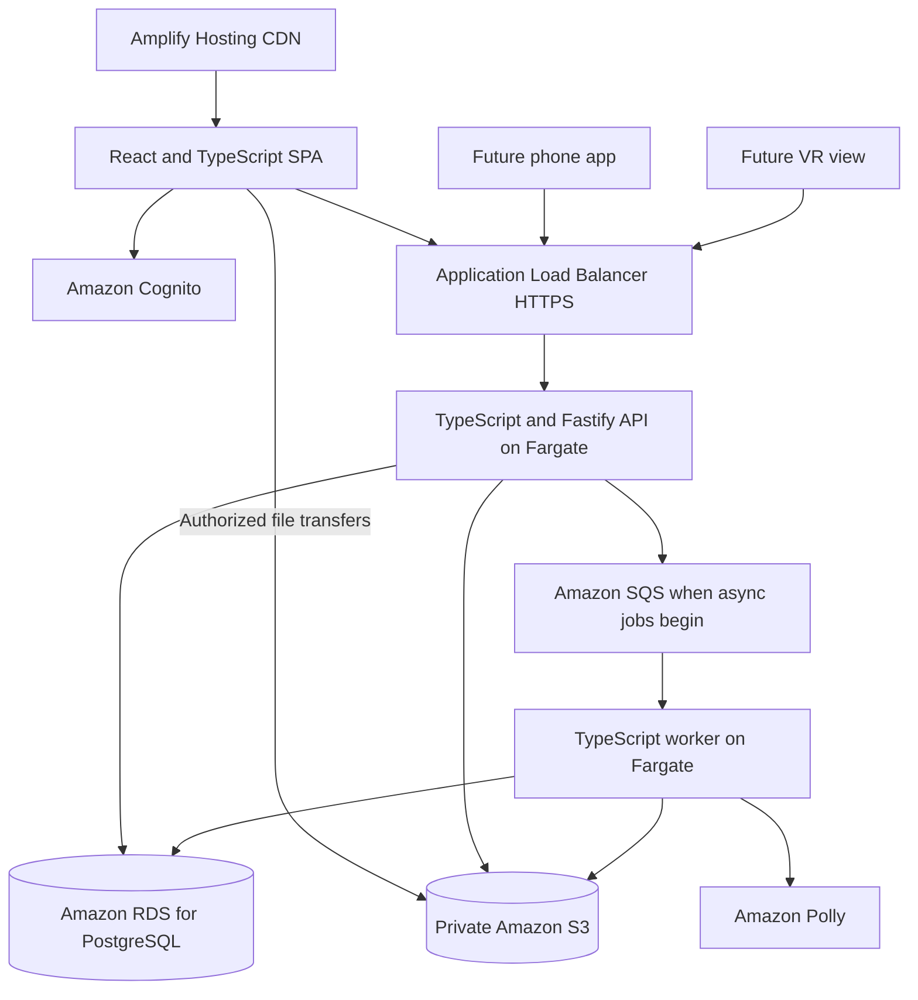

# Architecture proposal

This is a starting design for implementation. No packages, infrastructure, API endpoints, or cloud resources have been created.

## Stack direction

Use React and TypeScript for a client-rendered library, with React Router framework mode configured as an SPA and Vite for development and production builds. Use a Node.js/TypeScript API with Fastify. The owner authorized changing the earlier Perl direction to suit the interactive reader and AWS integration. This is the current implementation plan; no application code or dependencies exist yet.

The reasons for this choice are shared web/API data contracts, browser interaction tooling, and the official AWS SDK for JavaScript. Client rendering does not require a particular backend language, and changing languages alone does not establish a performance improvement. Keep maintained components, SQL, clear interfaces, and the Kiro-themed design as the foundation.

| Layer | Planned choice | Purpose |
| --- | --- | --- |
| Website | React, TypeScript, React Router SPA mode, and Vite | Browser-rendered shelves, reader, tracking, and notes with client navigation. |
| Server data cache | TanStack Query | Cache authenticated API results, deduplicate requests, and invalidate affected records after changes. |
| Local drafts | IndexedDB | Save pending note edits and operation IDs on the device; resolve revisions when syncing. |
| API | Node.js, TypeScript, and Fastify | Authentication checks, ownership, validation, records, and job creation through a versioned JSON API. |
| Database | Amazon RDS for PostgreSQL through node-postgres (`pg`) | Relational records, transactions, SQL migrations, and text search. Local development uses compatible PostgreSQL. |
| Background work | Amazon SQS and a TypeScript worker, introduced with the first slow job | Imports, whisper generation, and exports with retries and idempotent processing. |
| AWS access | Official AWS SDK for JavaScript v3 on the backend and worker | S3, Polly, SQS, and later service integrations using workload roles. |
| Phone app | React Native as a later candidate | Reuse API contracts and selected non-UI logic; validate native AR modules on the target phone. |
| VR | Three.js and WebXR, loaded only in the immersive view | Present shared books and notes on supported devices. |

[React Router SPA mode](https://reactrouter.com/how-to/spa) supplies the routing framework, while [Vite](https://vite.dev/guide/) produces the static frontend assets. [TanStack Query](https://tanstack.com/query/latest/docs/framework/react/overview) handles server state; local editor state remains in the editor. Route loaders may prefetch into the same query cache rather than maintaining a second independent data store.

Use [Fastify with TypeScript](https://fastify.dev/docs/latest/Reference/TypeScript/) for the API. Keep domain logic outside route handlers and validate input at runtime. Shared TypeScript types help clients agree on shape, but do not replace validation or authorization. Share schemas, edition-specific locators, revisions, and error contracts across the web and future phone clients; keep secrets and database code out of browser bundles.

## Rendering and performance

The authenticated library renders on the client after loading static HTML, CSS, and JavaScript. Shelf filtering within the loaded page, reader controls, text selection, and note editing run locally; fetching books, searching the whole library, and saving changes use the API. Client navigation should preserve reader and shelf state without full page reloads. JavaScript is required for the interactive app, so provide useful loading, error, and disabled-script messages.

A small public introduction page can be static or prerendered at build time. SPA mode does not require a runtime HTML server for the private library. Keep build-time rendering free of browser-only APIs; initialize the reader, IndexedDB, and WebXR after browser mounting. Configure [Amplify rewrites](https://docs.aws.amazon.com/amplify/latest/userguide/redirects.html) so valid app deep links open the shell while missing assets and API failures keep their real error responses.

### Work that should stay light

- Split code by route. Load the EPUB renderer when a book opens; load PDF and 3D libraries only when their views are used. The ordinary shelf should not download the VR engine.
- Serve compressed, content-hashed assets through the hosting CDN. Revalidate the HTML shell so deployments do not strand readers on obsolete asset references.
- Paginate library queries, load appropriately sized covers, and reserve cover dimensions. Add list virtualization only after measurements show that large shelves need it, with accessible keyboard behavior preserved.
- Cache account-scoped metadata with explicit freshness rules. Optimistic note updates show a pending state, retain drafts on failure, and offer conflict resolution.
- Keep uploaded book processing, OCR, speech generation, and database access on the backend. Move suitable browser-only parsing or hashing into a worker if profiling shows it blocking interaction.
- Use [IndexedDB](https://developer.mozilla.org/en-US/docs/Web/API/IndexedDB_API) for drafts and a later download store. A query cache alone is not durable offline sync. Clear account-scoped query caches on sign-out; explain and provide controls for retaining or clearing unsynced drafts and downloads on shared devices.
- Add a service worker only with a tested update and cache policy. The first website release promises recoverable local drafts; full offline books follow their own download and sync milestone.

The first proposed budget is at most 200 KiB of compressed JavaScript for the initial app shell, excluding later reader and immersive chunks. Reassess it against the production build and keep any exception explicit. Use [Core Web Vitals](https://web.dev/articles/vitals) targets of LCP at most 2.5 seconds, INP at most 200 milliseconds, and CLS at most 0.1 at the 75th percentile when field data is available. These are targets, not measured results.

Before release, record a representative phone, network profile, book sizes, and library sizes. Measure cold loads, repeat visits, opening a saved book, typing notes, and changing a large shelf filter. Compare before/after changes under the same conditions; measure API and database latency separately from client rendering. Initial JavaScript work and slow devices can make an SPA feel slower even when navigation is smoother.

## AWS optimization from browser to database

Optimize the current React/TypeScript stack across the whole request path. AWS supplies delivery, storage, workload hosting, and observability; application work still includes bundle size, queries, pagination, and cache correctness. All settings below are implementation requirements or conditional experiments, not configured resources or measured gains.

| Path | Baseline approach | Evidence to collect |
| --- | --- | --- |
| Frontend delivery | Use Amplify's managed CloudFront CDN. Give content-hashed assets long-lived immutable caching; revalidate the HTML shell and verify negotiated compression in the deployed responses. | Compressed transfer size, cache headers, cold/repeat LCP, and successful loading after a new deployment. |
| Book and cover transfer | The API authorizes a short-lived S3 URL; the browser transfers the bytes directly to S3. Use unique object keys, upload limits, checksums, and a finalize step before import. | Transfer duration and failure rate; API requests should carry metadata rather than whole book files. |
| Shelf covers | Generate a few responsive thumbnail sizes during import and store them in private S3. Serve only the size needed by the shelf. | Image bytes, layout shift, and shelf response time for a representative large library. |
| API ingress and identity | Use an Application Load Balancer for HTTPS ingress to healthy Fargate tasks. Verify Cognito tokens locally using cached public keys with expiry and key rotation handled. | API p50/p95 latency, error rate, CPU/memory, and authentication failures. |
| API capacity | Set bounded ECS task scaling, request timeouts, and graceful deployment behavior. Preserve a warm baseline if the budget supports it. | Latency and saturation under controlled load; deployments should drain active requests cleanly. |
| Database work | Put API, worker, RDS, S3, and SQS in a compatible region near expected users. Use indexed, owner-scoped queries, cursor pagination, bounded pools, and short transactions. | Query plans, query latency, pool wait time, active connections, CPU, and database I/O. |
| Import, speech, and exports | Send slow work through SQS. Show job status; scale the worker independently of interactive API traffic. Reuse cached Polly output. | Queue age, backlog per worker, retries, failed jobs, cache reuse, and speech requests per user. |
| User experience | Correlate CloudWatch API and database metrics with sampled browser measurements once the app is hosted. | Production Core Web Vitals by device class and route template, plus the associated API timing. |

Amplify [already uses CloudFront](https://docs.aws.amazon.com/amplify/latest/userguide/caching.html); use its cache/header controls rather than placing another distribution in front of the SPA. Verify the actual hosted response behavior. Long cache lifetimes apply only to immutable assets. Authenticated API responses and note data should not enter shared edge caches; disable shared caching for them and use private/no-store HTTP policy as appropriate. TanStack Query remains an account-scoped application cache.

Use [S3 presigned transfers](https://docs.aws.amazon.com/AmazonS3/latest/userguide/using-presigned-url.html) to keep file bandwidth out of the API process. Finalization verifies the selected object, size, checksum, and ownership, then creates a durable import job. Keep newly uploaded files unreadable to the ordinary reader until validation succeeds. The worker creates thumbnails and metadata once. Expired URLs require renewed authorization; retries must not overwrite another book or create duplicate imports.

An [Application Load Balancer](https://docs.aws.amazon.com/elasticloadbalancing/latest/application/introduction.html) provides the API's HTTPS entry point. Configure health checks and shutdown/draining behavior, and include ingress and networking costs in the hosting estimate. [Cognito JWT verification](https://docs.aws.amazon.com/cognito/latest/developerguide/amazon-cognito-user-pools-using-tokens-verifying-a-jwt.html) can use a reviewed verifier with cached issuer public keys; validate each token and its claims without a Cognito network lookup for every normal API request.

Use [ECS Service Auto Scaling](https://docs.aws.amazon.com/AmazonECS/latest/developerguide/service-auto-scaling.html) only with explicit minimum, maximum, and cooldown settings. Scale API tasks against observed request load and CPU/memory. Scale workers against queue backlog and age. Ensure the sum of API, worker, and migration connections fits the RDS connection budget at maximum task counts. More workers should not overwhelm the database or Polly service limits.

### Add services when measurements justify them

| Optional addition | Trigger | Validation before keeping it |
| --- | --- | --- |
| RDS Proxy | Connection churn or pool pressure persists as API/worker replicas grow, after tuning application pools. | Compare connection use, latency, failover behavior, and cost. It does not fix a slow query or replace indexes. |
| ElastiCache | Repeated expensive reads remain a measured database bottleneck after query/index work. | Use owner-scoped keys, expiry, invalidation, and deletion handling; measure hit rate and correctness under edits. Begin without a distributed cache. |
| CloudFront for private media | Distant readers repeatedly fetch the same covers or audio and S3 delivery latency is material. | Use signed access, a private S3 origin with OAC, and deletion/invalidation rules. Verify authorization on cache hits as well as misses. This is separate from the existing Amplify frontend CDN. |

[RDS Proxy](https://docs.aws.amazon.com/AmazonRDS/latest/UserGuide/rds-proxy.html) pools database connections. [ElastiCache](https://docs.aws.amazon.com/AmazonElastiCache/latest/dg/WhatIs.html) supplies a distributed in-memory cache. For optional media delivery, [CloudFront signed URLs or cookies](https://docs.aws.amazon.com/AmazonCloudFront/latest/DeveloperGuide/PrivateContent.html) restrict viewer access, while [origin access control](https://docs.aws.amazon.com/AmazonCloudFront/latest/DeveloperGuide/private-content-restricting-access-to-s3.html) protects the S3 origin. Choose an expiry and revocation/deletion policy before enabling private-media caching.

### Measure with privacy and cost controls

Start with CloudWatch API timings, errors, ECS utilization, RDS connection/query metrics, and SQS backlog/age. Add sampled [CloudWatch RUM](https://docs.aws.amazon.com/AmazonCloudWatch/latest/monitoring/CloudWatch-RUM.html) for the hosted pilot only after reviewing consent, collection settings, cost, and bundle impact. Use normalized route names and an allowlist of measurements. Exclude book titles/text, note content, coordinates, credentials, and presigned URL query strings; disable automatic URL/error capture that cannot meet those limits.

For each optimization, record the same device, network, dataset, and concurrency before and after. Track browser loading and interaction, API p95 latency, file-transfer timing, database wait time, queue delay, and cost per test workload. Keep the simplest configuration that meets the measured target. Spending alerts supplement application quotas and bounded capacity; they do not establish a guaranteed spending cap.

## Amazon connection

Amazon's [early online bookstore](https://press.aboutamazon.com/1995/10/worlds-largest-bookseller-opens-on-the-web) remains part of the inspiration. AWS services support the planned hosting, database, storage, identity, and whispers. The project is independent; describe its actual services and Kiro usage without implying affiliation or claims about Amazon's original storefront technology.

## AWS service plan

| Service | Planned responsibility | Phase |
| --- | --- | --- |
| AWS Amplify Hosting | Build and serve static SPA assets over the CDN with HTTPS and deep-link rewrites. | First hosted website. |
| Amazon ECS on AWS Fargate and Amazon ECR | Host the TypeScript API and later worker, and store their container images, with bounded scaling. | First hosted API; add worker capacity with async jobs. |
| Application Load Balancer | HTTPS API ingress, health checks, and routing to Fargate tasks. | First hosted API; include ingress costs in the budget. |
| Amazon RDS for PostgreSQL | Primary database for books, notes, reading records, and job status. | First hosted release; size and availability follow budget checks. |
| Amazon S3 | Private books, covers, exports, and cached whisper audio. | First hosted release. |
| Amazon Cognito | Managed login using authorization-code flow and PKCE. | First account-enabled release. |
| Amazon Polly | Optional short book whispers, with text fallback. | First website demo. |
| Amazon SQS | Queue slow jobs with retry limits and a dead-letter queue. | First asynchronous import or speech job. |
| AWS Secrets Manager | Database credentials and application secrets. | First hosted API. |
| Amazon CloudWatch and AWS Budgets | Operational logs, metrics, and spending alerts; optional sampled RUM after privacy and cost review. | Hosted release, with browser monitoring evaluated for the pilot. |
| Amazon Textract | Optional selected-image text extraction. | Later capture experiment. |
| Amazon Bedrock | Optional recall and note discovery using reader-selected content. | Later experiment. |

[Amplify Hosting](https://docs.aws.amazon.com/amplify/latest/userguide/welcome.html) handles the frontend deployment. It is separate from the API on Fargate and the private book bucket. Do not place uploaded books inside public frontend assets. Connect the repository or create hosting resources only during an authorized deployment task.

The backend and worker use the [AWS SDK for JavaScript v3](https://docs.aws.amazon.com/sdk-for-javascript/v3/developer-guide/welcome.html) with task roles and temporary credentials. Check service operations, timeouts, retries, signed file access, and credential refresh. Private object transfers can use [S3 presigned URLs](https://docs.aws.amazon.com/AmazonS3/latest/userguide/using-presigned-url.html) issued after checking ownership. The browser holds no AWS secret access keys or database credentials.

The SPA uses a public Cognito app client with no client secret and [authorization-code flow with PKCE](https://docs.aws.amazon.com/cognito/latest/developerguide/authorization-endpoint.html). Prefer short-lived tokens held in memory, and explicitly design refresh and session expiration. The API validates access tokens and their issuer, signature, expiry, client, and scopes, then checks record ownership. Restrict CORS to deployed app origins; a frontend route guard is only a UI control.

Fargate keeps the API process and its database connection pools alive across requests. This is a practical starting point alongside the chosen RDS database. Confirm region, HTTPS ingress, private networking, workload roles, secrets, and total cost before provisioning. Lambda remains an option for a future isolated event handler; switching the main SQL API to Lambda would require a separate concurrency and database-connection design.

Introduce SQS when the first slow job needs it. Create the job record and enqueue intent transactionally, then publish from a durable outbox so a queue failure does not lose the request. Consumers check ownership, use stable operation IDs, and record completion before acknowledging messages. [SQS standard queues can deliver messages more than once](https://docs.aws.amazon.com/AWSSimpleQueueService/latest/SQSDeveloperGuide/standard-queues-at-least-once-delivery.html), so retrying a job must not duplicate notes, sessions, or speech charges unnecessarily. Store record IDs instead of private book or note text in queue payloads.

## Primary database decision

Use **Amazon RDS for PostgreSQL** for the hosted application. Books, annotations, notes, reading attempts, sessions, and spatial placements have related records and ownership rules. A relational model lets the app update progress and reading history in a transaction, preserve references to the correct book edition, and search notes without introducing another datastore. This is the project-specific reason for choosing an AWS-managed SQL database.

[RDS for PostgreSQL](https://docs.aws.amazon.com/AmazonRDS/latest/UserGuide/CHAP_PostgreSQL.html) supports ordinary PostgreSQL clients. The TypeScript API connects using node-postgres (`pg`) over a verified TLS connection. Use a [bounded connection pool](https://node-postgres.com/features/pooling), parameterized queries, and explicit SQL migrations; AWS SDK calls are separate from SQL queries. Store book files, covers, and audio in S3, with private object references in RDS.

[Amazon DynamoDB](https://docs.aws.amazon.com/amazondynamodb/latest/developerguide/Introduction.html) is another AWS database with a key-value/document model. Its access-pattern-driven design would require a different data model. Keep one primary RDS database for the current library rather than introducing a second datastore. Reassess only when a measured requirement calls for it.

### Data and connection rules

- Scope every record query to the authenticated owner. Define foreign keys, ownership-aware references, uniqueness constraints, and indexes when the SQL schema is implemented.
- Use transactions for related updates and revision checks for note edits. Keep durable job status and enqueue-intent records in RDS, with queue messages referencing record IDs rather than private text.
- Place RDS in private subnets with public access disabled. Limit database network access to the application and worker security groups. Clients access data through the authenticated TypeScript API.
- Store database credentials in [AWS Secrets Manager](https://docs.aws.amazon.com/secretsmanager/latest/userguide/intro.html). Use a restricted application database role and a separate migration role. Plan credential rotation and connection renewal before enabling rotation.
- Require TLS with certificate and hostname verification. Set connection and statement timeouts, bounded connection pools, encrypted storage, backups, and an explicit retention policy.
- Use local PostgreSQL with a compatible major version for development. Verify extension support and migrations against the selected RDS engine before deployment; keep provider-specific administration out of application migrations.
- Before provisioning, choose an AWS region, database size, availability settings, backup retention, and budget. Record those actual values only when agreed. Verify backup restoration before a public release.

## Shared records

| Record | Responsibility |
| --- | --- |
| User | Account identity, reader preferences, and sound settings. |
| Book | Owner, metadata, collections, file reference, format, edition identifier, and import state. |
| Reading record | A reading attempt, status, start and finish dates, last location, manual progress, and revision. Rereads get a new record. |
| Reading session | Start time, duration, progress change, and any manual corrections. |
| Annotation | Book edition, location or range, selected text, and optional highlight color. |
| Note | Owner, optional book and annotation references, title, body, tags, timestamps, and revision. |
| Place memory | Note reference, place label, optional coordinates, accuracy, and reminder radius. |
| Spatial placement | Note reference, AR or VR context, coordinate frame, transform, and optional anchor provider reference. |
| Whisper asset | Owner, source text hash, voice, engine, locale, audio reference, and generation state. |

A note keeps one identity across all clients. Its text is separate from its location and spatial placements, so losing an AR anchor does not lose the note. A note may appear in a real room and in the VR library at different positions.

## Book import and reading

1. Authenticate the upload request, enforce limits, and issue a short-lived URL for a unique private S3 object. Finalize the direct upload with verified object metadata and enqueue the import idempotently.
2. Validate the file contents and inspect archives with limits on expanded size and entry count.
3. Extract metadata and ask the owner to confirm it. Store the original privately.
4. Open book content in an isolated reader that blocks book scripts and unapproved network requests.
5. Save locations and annotation ranges against the exact imported edition.

EPUB locations should use the chosen renderer's stable location scheme, with chapter references and selected-text context for recovery. PDF uses page indices and separate annotation coordinates. If the file changes, preserve old annotations and ask for remapping instead of assuming locations still match.

EPUB is a structured publication format; implementation should follow [W3C EPUB 3.3](https://www.w3.org/TR/epub-33/). Renderer selection still needs validation against sample books, accessibility requirements, and licensing.

## Polly whispers

Build short text on the backend from approved templates and book metadata. Escape inserted text before wrapping it in SSML. Use Polly's standard engine and a compatible voice for the whispered effect; AWS documents that the effect is [supported only by standard TTS](https://docs.aws.amazon.com/polly/latest/dg/whispered-tag.html).

Cache the resulting audio using the owner, text hash, voice, engine, and locale. Reuse it on replay. Apply per-user request limits and an application-level speech allowance before public use. Add AWS spending alerts separately; alerts are not a guaranteed hard spending cap. Audio is optional; return visible text when synthesis or playback fails. Ordinary reader narration, if added later, needs its own voice and engine selection.

Only send the short whisper text to Polly. Sending a private note or a book passage for speech would require a separate product choice. Delete associated audio when its source or account is deleted. Polly's [service overview](https://docs.aws.amazon.com/polly/latest/dg/what-is.html) describes speech synthesis and caching.

## Sync and offline behavior

Use server-owned record IDs, revisions, and client operation IDs. Retrying an upload, reading-session save, or note edit must not create duplicates. Preserve deletion records long enough to stop an offline device from restoring removed content.

For notes, reject stale revisions and offer both versions for resolution. Store progress against a reading record and edition. Moving backward in a book is valid, so resolving progress by choosing the largest percentage would be incorrect. Keep sessions separate from the current reading position.

Start the website with local note drafts and an explicit sync state. Full offline books need a download, storage, and eviction policy. Shared accounts and private files require authentication, authorization, export, and deletion behavior before cross-device sync ships.

## Location, AR, and VR

Request location only when attaching a place or opening nearby notes. Store selected places and accuracy rather than a continuous location trail. Background reminders belong to a later mobile milestone and need explicit permission and supported platform behavior.

Phone camera notes require surface or marker tracking and a strategy for finding the anchor again. A camera overlay alone does not establish a persistent anchor. Prototype local markers or assisted placement first; evaluate platform-specific persistent anchors only if needed. Explain any remote processing before enabling it.

Store anchor coordinates with their coordinate frame and provider. Do not treat GPS coordinates, a phone's local AR frame, and a VR room's coordinates as interchangeable. Expired or missing anchors should leave the note accessible and available for placement again.

For the browser VR experiment, evaluate Three.js with WebXR after the core clients work. WebXR requires HTTPS and has [limited browser availability](https://developer.mozilla.org/en-US/docs/Web/API/WebXR_Device_API). Detect capabilities at runtime and keep a standard notes interface available. Persistent AR anchors and background location reminders are separate capabilities and must be assessed on each target platform.

## Future feature boundaries

Photo-to-note capture should upload only the cropped image the reader explicitly selects. Use [Amazon Textract](https://docs.aws.amazon.com/textract/latest/dg/what-is.html) to propose extracted text, then ask the reader to correct it and choose a book or passage. OCR does not automatically identify a reliable EPUB location. Define temporary-image deletion and retry behavior before enabling uploads.

Recall prompts can first resurface a saved highlight and ask the reader to explain it in their own words. That version needs ordinary note records and scheduling rules. A later [Amazon Bedrock](https://docs.aws.amazon.com/bedrock/latest/userguide/what-is-bedrock.html) experiment may draft questions or suggest related notes, with explicit selection of the content sent to the service. Returned suggestions must link to actual note IDs and show when no supporting note exists. Notes are untrusted content, never instructions for tool use. Check model availability, data handling, retention, and cost before enabling a model.

A note constellation begins with links the reader creates between their notes. Render those links in a small graph with a searchable list alternative. Semantic suggestions can follow later; readers accept or reject them. Neither camera capture nor recall prompts should automatically send entire books or the whole private library to a service.

## Implementation and deployment sequence

1. Select compatible maintained Node.js, React Router, Vite, Fastify, and PostgreSQL versions. Record actual dependency versions and licenses when installed. No packages are installed at this stage.
2. Build a small local vertical slice: a client-rendered shelf and note editor using the TypeScript API and PostgreSQL. Validate ownership, runtime schemas, transactions, and revision conflicts.
3. Add the isolated EPUB renderer as a lazy-loaded route with persistent locators and local note drafts. Measure the production app shell and interaction costs on a representative phone.
4. Validate Cognito login, account-scoped cache cleanup, S3 access, and Polly caching with official SDK clients. Introduce SQS and the worker with slow jobs and verify duplicate-message and outbox recovery behavior.
5. Prepare Amplify Hosting cache headers and deep-link rewrites; validate compression and deployment updates. Prepare ALB HTTPS ingress, bounded Fargate API/worker scaling, private RDS and S3 access, Secrets Manager, backups, and CloudWatch. Verify direct file transfers, TLS, aggregate pool limits, migrations, and backup restoration.
6. Estimate the complete hosting cost, including ingress and networking, and set quotas and AWS Budgets alerts before provisioning. Measure the baseline before enabling optional RUM, RDS Proxy, ElastiCache, or private-media CloudFront. Keep OCR and model calls disabled until their later milestones.

Use original or permitted sample books and a dedicated demo account. Verify reader persistence, notes, exports, deletion, keyboard access, mobile layouts, expired sessions, offline recovery, and cache isolation before sharing a demo. No speedup, live endpoint, or deployment command is claimed at the current documentation stage.
