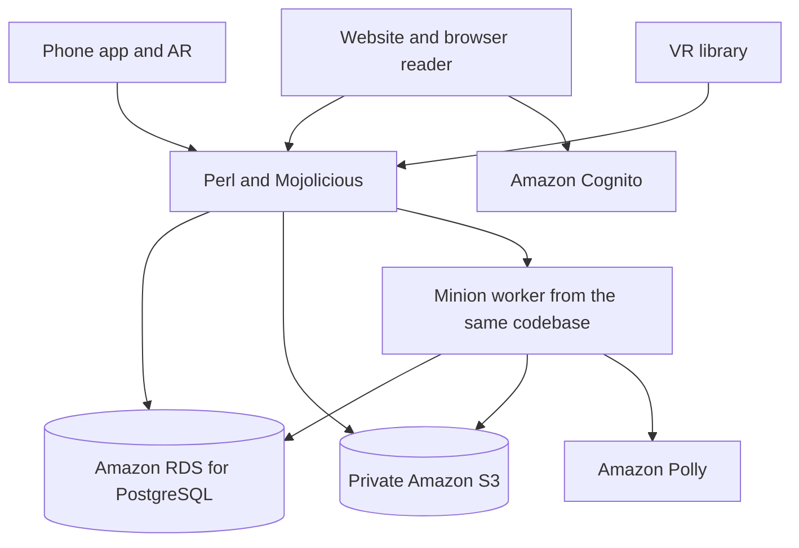

# Architecture proposal

This is a starting design for implementation. No packages, infrastructure, API endpoints, or cloud resources have been created.

## Stack direction

The owner chose Perl as the backend language and wants mature technology refined for a modern reading app. Use maintained releases and dependencies. The proposed framework is Mojolicious, with server-rendered HTML, a focused JavaScript or TypeScript reader, and Amazon RDS for PostgreSQL as the hosted database. This replaces the earlier Next.js backend proposal. No runtime or package versions are pinned until implementation and compatibility checks begin.

| Layer | Proposed choice | Purpose |
| --- | --- | --- |
| Application | Perl 5 and Mojolicious | Book records, reading history, notes, authorization, HTML pages, and a versioned JSON API. |
| Website | Mojolicious templates, semantic HTML, CSS, and small browser modules | Render shelves and forms on the server; use browser code for EPUB reading, selection, local drafts, and immersive views. |
| Database | Amazon RDS for PostgreSQL through Mojo::Pg and DBD::Pg | Primary hosted database for library records, transactions, SQL migrations, and text search. Local development uses a compatible PostgreSQL release. |
| Background work | Minion with a PostgreSQL backend, introduced with import and audio jobs | Keep file processing and speech requests outside interactive page requests; no separate queue service initially. |
| AWS access | A small Perl adapter, initially evaluating Paws for S3 and Polly | Keep service-specific code away from book and note rules. Validate supported operations and role credentials before adopting it. |
| Phone app | React Native as a later candidate, with native AR integrations evaluated on the target phone | Consume the same API; the phone does not run the Perl backend. |
| VR | Three.js and WebXR as a later experiment | Present shared books and notes in a virtual room on supported devices. |

[Mojolicious rendering](https://docs.mojolicious.org/Mojolicious/Guides/Rendering), [Mojo::Pg](https://docs.mojolicious.org/Mojo/Pg), and [Minion](https://docs.mojolicious.org/Minion) provide the starting references. Keep domain rules in Perl modules, separate from route handlers. Use parameterized SQL and explicit migrations. Plain HTML forms should support library management and basic notes; richer reading and camera interactions can require browser code.

The website, phone, and VR clients share API contracts and persisted records rather than assuming they can share Perl domain code. Define consistent schemas, edition-specific locators, revision rules, and error responses before adding a second client.

## Amazon connection

The project combines a book-focused experience with Perl and selected AWS services. Amazon's [1995 bookstore announcement](https://press.aboutamazon.com/1995/10/worlds-largest-bookseller-opens-on-the-web) supports the bookstore inspiration. AWS also published [Perl workload and Paws guidance](https://aws.amazon.com/blogs/developer/hello-perl-developers/).

These sources do not establish which language powered the original Amazon storefront. Keep that historical claim unverified unless a reliable primary account is found. Describe this as an independent project inspired by early online bookstores, with a Perl backend and AWS integrations. Do not imply Amazon affiliation or reuse of Amazon's original code.

## AWS service plan

| Service | Planned responsibility | Phase |
| --- | --- | --- |
| Amazon S3 | Private books, covers, exports, and cached whisper audio. | First hosted release. |
| Amazon Polly | Short, optional book whispers, with text fallback. | First website demo. |
| Amazon RDS for PostgreSQL | Selected primary database for books, notes, reading records, and job metadata. | First hosted release. Size, region, backup retention, and cost are checked before provisioning. |
| Amazon Cognito | Planned managed login, with authorization-code flow and PKCE. | First account-enabled release; validate the complete sign-in flow. |
| Amazon ECS on AWS Fargate and Amazon ECR | Planned container hosting and image storage for the Perl web process and job worker. | First hosted release, after estimating baseline costs. |
| AWS Secrets Manager | Database credentials and application secrets, with access restricted to the appropriate workload. | First hosted release. |
| Amazon CloudWatch and AWS Budgets | Operational logs, metrics, and spending alerts. | Hosted release. |
| Amazon Textract | Optional photo-to-note text extraction from a user-selected image. | Later capture experiment. |
| Amazon Bedrock | Optional recall questions and semantic note discovery from selected personal notes. | Later experiment after privacy and usefulness checks. |

Use [S3 presigned URLs](https://docs.aws.amazon.com/AmazonS3/latest/userguide/using-presigned-url.html) for time-limited access after checking ownership. Use [RDS PostgreSQL](https://docs.aws.amazon.com/AmazonRDS/latest/UserGuide/CHAP_PostgreSQL.html) for the same relational model used locally. Implement and validate [Cognito authorization](https://docs.aws.amazon.com/cognito/latest/developerguide/authorization-endpoint.html) separately from AWS SDK coverage; login uses standard browser redirects and token handling.

A container allows the application to carry its Perl runtime and native dependencies. [Fargate](https://docs.aws.amazon.com/AmazonECS/latest/developerguide/AWS_Fargate.html) is the planned container host. Infrastructure has not been provisioned. Confirm region, TLS termination, private database networking, task roles, secrets injection, worker capacity, and total ongoing cost before deployment. Begin local development without requiring a paid cloud environment.

Use task roles and temporary credentials in production. The Perl adapter must demonstrate working S3 uploads/downloads, signed access, Polly streaming, retries, timeouts, and role credential refresh. [Paws](https://metacpan.org/pod/Paws) is a community SDK; its [Polly operation documentation](https://metacpan.org/pod/Paws::Polly::SynthesizeSpeech) is a starting point, not proof that every current AWS API works. If a required operation is missing, evaluate a narrow worker using an official AWS SDK before adding another language. Avoid bespoke request signing and shelling out with user input.

Start with one backend and one database. Introduce a worker with the first slow job, then reuse it for import, speech, and exports. Do not add DynamoDB, OpenSearch, a vector database, or a separate event system without a demonstrated need. Text search starts in PostgreSQL.

The backend checks ownership on every request. Keep AWS credentials on the server. A login token identifies a user; each book, note, file, and job still needs an ownership check. Protect cookie-authenticated forms against CSRF and validate tokens, callback state, and issuer/audience through reviewed libraries.

## Primary database decision

Use **Amazon RDS for PostgreSQL** for the hosted application. Books, annotations, notes, reading attempts, sessions, and spatial placements have related records and ownership rules. A relational model lets the app update progress and reading history in a transaction, preserve references to the correct book edition, and search notes without introducing another datastore. This is the project-specific reason for choosing an AWS-managed SQL database.

[RDS for PostgreSQL](https://docs.aws.amazon.com/AmazonRDS/latest/UserGuide/CHAP_PostgreSQL.html) supports ordinary PostgreSQL clients. The Perl backend connects using Mojo::Pg/DBD::Pg over a verified TLS connection; Paws is for AWS service API calls and is not required for ordinary SQL queries. Store book files, covers, and audio in S3, with private object references in RDS.

[Amazon DynamoDB](https://docs.aws.amazon.com/amazondynamodb/latest/developerguide/Introduction.html) is another AWS database with a key-value/document model. Its access-pattern-driven design would require a different data model. Keep one primary RDS database for the current library rather than introducing a second datastore. Reassess only when a measured requirement calls for it.

### Data and connection rules

- Scope every record query to the authenticated owner. Define foreign keys, ownership-aware references, uniqueness constraints, and indexes when the SQL schema is implemented.
- Use transactions for related updates and revision checks for note edits. Keep Minion job tables separate from application tables and store record IDs rather than private text in job payloads where possible.
- Place RDS in private subnets with public access disabled. Limit database network access to the application and worker security groups. Clients access data through the Perl API.
- Store database credentials in [AWS Secrets Manager](https://docs.aws.amazon.com/secretsmanager/latest/userguide/intro.html). Use a restricted application database role and a separate migration role. Plan credential rotation and connection renewal before enabling rotation.
- Require TLS with certificate and hostname verification. Set connection and statement timeouts, bounded connection pools, encrypted storage, backups, and an explicit retention policy.
- Use local PostgreSQL with a compatible major version for development. Verify extension support and migrations against the selected RDS engine before deployment; keep provider-specific administration out of application migrations.
- Before provisioning, choose an AWS region, database size, availability settings, backup retention, and budget. Record those actual values only when agreed. Verify backup restoration before a public release.

## Shared records

| Record | Responsibility |
| --- | --- |
| User | Account identity, reader preferences, and sound settings. |
| Book | Owner, metadata, collections, file reference, format, edition identifier, and import state. |
| Reading record | A reading attempt, status, start and finish dates, last location, manual progress, and revision. Rereads get a new record. |
| Reading session | Start time, duration, progress change, and any manual corrections. |
| Annotation | Book edition, location or range, selected text, and optional highlight color. |
| Note | Owner, optional book and annotation references, title, body, tags, timestamps, and revision. |
| Place memory | Note reference, place label, optional coordinates, accuracy, and reminder radius. |
| Spatial placement | Note reference, AR or VR context, coordinate frame, transform, and optional anchor provider reference. |
| Whisper asset | Owner, source text hash, voice, engine, locale, audio reference, and generation state. |

A note keeps one identity across all clients. Its text is separate from its location and spatial placements, so losing an AR anchor does not lose the note. A note may appear in a real room and in the VR library at different positions.

## Book import and reading

1. Authenticate the upload and enforce file size, format, and storage limits.
2. Validate the file contents and inspect archives with limits on expanded size and entry count.
3. Extract metadata and ask the owner to confirm it. Store the original privately.
4. Open book content in an isolated reader that blocks book scripts and unapproved network requests.
5. Save locations and annotation ranges against the exact imported edition.

EPUB locations should use the chosen renderer's stable location scheme, with chapter references and selected-text context for recovery. PDF uses page indices and separate annotation coordinates. If the file changes, preserve old annotations and ask for remapping instead of assuming locations still match.

EPUB is a structured publication format; implementation should follow [W3C EPUB 3.3](https://www.w3.org/TR/epub-33/). Renderer selection still needs validation against sample books, accessibility requirements, and licensing.

## Polly whispers

Build short text on the backend from approved templates and book metadata. Escape inserted text before wrapping it in SSML. Use Polly's standard engine and a compatible voice for the whispered effect; AWS documents that the effect is [supported only by standard TTS](https://docs.aws.amazon.com/polly/latest/dg/whispered-tag.html).

Cache the resulting audio using the owner, text hash, voice, engine, and locale. Reuse it on replay. Apply per-user request limits and an application-level speech allowance before public use. Add AWS spending alerts separately; alerts are not a guaranteed hard spending cap. Audio is optional; return visible text when synthesis or playback fails. Ordinary reader narration, if added later, needs its own voice and engine selection.

Only send the short whisper text to Polly. Sending a private note or a book passage for speech would require a separate product choice. Delete associated audio when its source or account is deleted. Polly's [service overview](https://docs.aws.amazon.com/polly/latest/dg/what-is.html) describes speech synthesis and caching.

## Sync and offline behavior

Use server-owned record IDs, revisions, and client operation IDs. Retrying an upload, reading-session save, or note edit must not create duplicates. Preserve deletion records long enough to stop an offline device from restoring removed content.

For notes, reject stale revisions and offer both versions for resolution. Store progress against a reading record and edition. Moving backward in a book is valid, so resolving progress by choosing the largest percentage would be incorrect. Keep sessions separate from the current reading position.

Start the website with local note drafts and an explicit sync state. Full offline books need a download, storage, and eviction policy. Shared accounts and private files require authentication, authorization, export, and deletion behavior before cross-device sync ships.

## Location, AR, and VR

Request location only when attaching a place or opening nearby notes. Store selected places and accuracy rather than a continuous location trail. Background reminders belong to a later mobile milestone and need explicit permission and supported platform behavior.

Phone camera notes require surface or marker tracking and a strategy for finding the anchor again. A camera overlay alone does not establish a persistent anchor. Prototype local markers or assisted placement first; evaluate platform-specific persistent anchors only if needed. Explain any remote processing before enabling it.

Store anchor coordinates with their coordinate frame and provider. Do not treat GPS coordinates, a phone's local AR frame, and a VR room's coordinates as interchangeable. Expired or missing anchors should leave the note accessible and available for placement again.

For the browser VR experiment, evaluate Three.js with WebXR after the core clients work. WebXR requires HTTPS and has [limited browser availability](https://developer.mozilla.org/en-US/docs/Web/API/WebXR_Device_API). Detect capabilities at runtime and keep a standard notes interface available. Persistent AR anchors and background location reminders are separate capabilities and must be assessed on each target platform.

## Future feature boundaries

Photo-to-note capture should upload only the cropped image the reader explicitly selects. Use [Amazon Textract](https://docs.aws.amazon.com/textract/latest/dg/what-is.html) to propose extracted text, then ask the reader to correct it and choose a book or passage. OCR does not automatically identify a reliable EPUB location. Define temporary-image deletion and retry behavior before enabling uploads.

Recall prompts can first resurface a saved highlight and ask the reader to explain it in their own words. That version needs ordinary note records and scheduling rules. A later [Amazon Bedrock](https://docs.aws.amazon.com/bedrock/latest/userguide/what-is-bedrock.html) experiment may draft questions or suggest related notes, with explicit selection of the content sent to the service. Returned suggestions must link to actual note IDs and show when no supporting note exists. Notes are untrusted content, never instructions for tool use. Check model availability, data handling, retention, and cost before enabling a model.

A note constellation begins with links the reader creates between their notes. Render those links in a small graph with a searchable list alternative. Semantic suggestions can follow later; readers accept or reject them. Neither camera capture nor recall prompts should automatically send entire books or the whole private library to a service.

## Implementation and deployment sequence

1. Confirm a supported Perl release and compatible Mojolicious, PostgreSQL, and CPAN modules. Record exact versions and licenses when dependencies are installed.
2. Build a small local slice: add a book, render a shelf, save a note, and expose the same records through the JSON API. Verify ownership, transactions, and note revisions.
3. Validate an isolated EPUB reader and persistent passage locators. Use Test::Mojo for meaningful HTTP behavior checks when implementation begins.
4. Prove S3 and Polly access through the Perl adapter, including temporary credentials, failure handling, caching, and an application speech allowance. Add the worker when slow jobs are introduced.
5. Validate Cognito sign-in and session behavior. Prepare ECS/Fargate hosting with HTTPS, private RDS for PostgreSQL, private S3 access, Secrets Manager, backups, and CloudWatch logs that exclude private content. Test migrations, database TLS verification, connection limits, and restoring a backup.
6. Check the complete hosting estimate before provisioning. Configure [AWS Budgets](https://docs.aws.amazon.com/cost-management/latest/userguide/budgets-managing-costs.html) alerts alongside application quotas. Keep OCR and model calls disabled until their later milestones.

Use original or permitted sample books and a dedicated demo account. Confirm export, deletion, permissions, reader persistence, and mobile layouts before sharing a demo. There is no deployment command or live endpoint at the current documentation stage.
